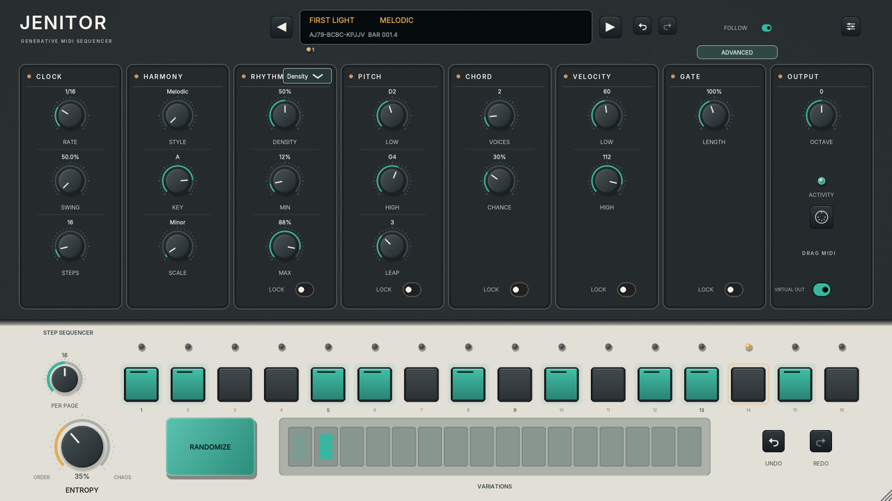

# JENITOR

**A free generative, polyphonic MIDI sequencer for macOS by remeedee.**

Create in-key melodies, chords and rhythms. Keep the parts you like with lane locks, then explore new variations with Randomize and Entropy.

## Download

### [Download JENITOR for macOS](https://github.com/helysx99/Jenitor/releases/latest/download/JENITOR-macos-free.zip)

[User guide (PDF)](https://github.com/helysx99/Jenitor/releases/latest/download/JENITOR-User-Guide.pdf) · [All release files](https://github.com/helysx99/Jenitor/releases/latest) · [Report a problem](https://github.com/helysx99/Jenitor/issues/new/choose)

**Current version: 0.6.1** · **macOS 14+** · **Apple Silicon and Intel**

The download includes the installer, a START HERE guide and the full PDF manual. Use the link above for the plugin; GitHub's **Code → Download ZIP** downloads this documentation repository.



## Install

1. Download and extract the macOS ZIP.
2. Close your DAW and open the installer package.
3. If macOS blocks it, first attempt to open the package, then go to **System Settings → Privacy & Security → Open Anyway** and confirm. Only approve a download you trust.
4. Follow Installer's steps. An administrator password may be required. Choose **Customize** to install Audio Units, VST3, or both.
5. Restart your DAW and rescan plugins if needed.

This free release uses **ad-hoc-signed plugin binaries** and an **unsigned installer**. It is not Apple Developer ID-signed or notarized, so macOS approval may be necessary. Managed Macs can prohibit overrides. No installer scripts change Gatekeeper or remove quarantine automatically.

If you have older JENITOR copies under your home folder's `Library/Audio/Plug-Ins`, move them outside the scanning folders before using the installer. Duplicate plugin identities can make the DAW load the wrong version.

[Detailed installation and troubleshooting](docs/INSTALL.html) · [Read the PDF manual in this repository](docs/JENITOR-User-Guide.pdf)

## Choose the right format

| Host | Format | Routing |
|---|---|---|
| Logic Pro | **JENITOR MFX** / AU MIDI FX | Insert in a software-instrument track's MIDI FX slot, before its instrument. |
| Ableton Live | **JENITOR VST3** | Load on one MIDI track. On a second instrument track, select the JENITOR track/plugin as **MIDI From** and set **Monitor: In**. |
| Other compatible hosts | **JENITOR VST3** or **AU instrument** | Route generated MIDI to a sound-producing instrument using the host's routing. |

**JENITOR generates MIDI only. It does not contain a synthesizer or make sound by itself.** Start your DAW transport to play the pattern. A virtual CoreMIDI source is also available; avoid sending both routes to the same instrument if notes are doubled.

## What you can do

- Generate patterns up to **128 steps** with up to **eight voices**.
- Browse **105 scale entries**, search by name/category, or define a custom scale.
- Choose Density, Euclidean, Polymeter, Cellular, Probability Curve or Fill rhythm modes.
- Edit per-step probability, ratchets, gate type and accents.
- Explore chord shapes, inversions, voicings, contours and progressions.
- Lock individual lanes, recall seeds, evolve patterns and morph stored variations.
- Add timing, velocity and gate variation with Humanize and groove templates.
- Import PPQ MIDI files, follow held MIDI notes, learn CCs and route melody/chord voices separately.
- Drag generated MIDI into your DAW as a full loop, current page or fixed-bar clip.

The [12-page user guide](docs/JENITOR-User-Guide.pdf) explains the controls, defaults, routing and current limits. Cellular evolution cycles after 256 generations; MIDI import uses a 1/16 grid and does not support SMPTE timing.

## Installation locations

The installer installs for all users:

```text
/Library/Audio/Plug-Ins/Components/JENITOR.component
/Library/Audio/Plug-Ins/Components/JENITOR MFX.component
/Library/Audio/Plug-Ins/VST3/JENITOR.vst3
```

To uninstall, close your DAW and move these bundles to Trash. Also check the equivalent folders in your home Library if you previously installed manually.

## Help and feedback

[Open an issue](https://github.com/helysx99/Jenitor/issues/new/choose) with your JENITOR version, macOS version, Mac architecture, DAW/version, plugin format, routing and reproduction steps. For a generation problem, include the seed and relevant settings. Please avoid uploading private projects or personal information.

This repository is JENITOR's public home for downloads, screenshots and documentation.
